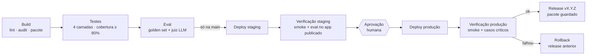

# Val · agente de IA com esteira de CI/CD no Azure

Trabalho da disciplina **Deploy e CI/CD** — MBA AI Engineering & Multi-Agent
Systems, FIAP, turma 3AIER, prof. Fabiano da Silva Carneiro.
Aluna: **Sabrina Otoni**.

A Val é a atendente de internet da **Nimbus Telecom, uma empresa fictícia**.
Ela nasceu do agente usado nas aulas ([agentebase](https://github.com/FabianoCarneiro/agentebase),
perfil `agent-val.md`) e ganhou o que faltava para ir para produção com
segurança: API, front, testes, evals que bloqueiam a esteira, deploy em dois
ambientes no Azure, aprovação humana, release versionada e rollback.

| | |
|---|---|
| Produção | <!--URL_PRODUCAO--> |
| Staging | <!--URL_STAGING--> |
| Esteira | [Actions](../../actions/workflows/esteira.yml) |
| Versões publicadas | [Releases](../../releases) |

---

## Como funciona

```mermaid
flowchart LR
    U([Cliente no navegador]) -->|HTTPS| F[Front<br/>web/]
    F -->|POST /api/chat| A[API FastAPI<br/>api.py]
    A --> L[Loop do agente<br/>agent.py]
    L -->|chat.completions + tools| O[(Azure OpenAI<br/>modelo em versão datada)]
    L --> T1[consultar_base]
    L --> T2[abrir_chamado]
    L --> T3[somar]
    T1 --> K[(dados/base_nimbus.json)]
    C[config/agente.json<br/>prompts/val-v1.md] -.versionados no Git.-> L
    subgraph Azure App Service · Linux · Python 3.12 · plano F1
      F
      A
      L
    end
```

- **O agente** ([agent.py](agent.py)) é o mesmo loop da aula: manda a conversa e
  as ferramentas ao modelo, executa a ferramenta que ele pedir, repete até vir
  texto. Ganhou três ferramentas e um *rastro* (ferramentas usadas, tokens).
- **A API** ([api.py](api.py)) não guarda estado: o front manda o histórico a
  cada turno. Valida o pedido, recusa mensagem de sistema vinda do cliente,
  limita mensagens por IP (o site é público e cada pergunta custa), registra
  cada atendimento em uma linha de log JSON (só metadados) e devolve a
  resposta com as ferramentas usadas, a latência e os tokens.
- **Guardrails:** senha, cartão, CVV e código de verificação são mascarados
  **antes** de a conversa ir para o modelo, e a resposta começa com um aviso
  fixo (regra de segurança não depende do modelo). Pedido barrado pelo filtro
  de conteúdo do Azure vira uma recusa educada.
- **Modelos** (Azure OpenAI, Brazil South): agente `gpt-4.1-mini` 2025-04-14;
  juiz do eval `gpt-5-mini` 2025-08-07, de outra geração. Prompt em uso:
  [prompts/val-v2.md](prompts/val-v2.md) — a v1 foi barrada pelo eval (11/22).
- **O front** ([web/](web/)) é HTML, CSS e JavaScript, sem build. Mostra, em
  cada resposta, o que a Val fez para chegar nela ("consultou a base",
  "abriu chamado NIM-…"), e no painel lateral os **bastidores da esteira**:
  ambiente, versão, commit, data do build, modelo e prompt que estão no ar.
- **O estado desejado mora no Git** ([config/agente.json](config/agente.json)):
  modelo fixado em versão datada, temperatura, versão do prompt, canário,
  limites e os critérios do eval. Mudar qualquer um é um PR.

## A esteira



| Etapa | O que faz | Para a esteira se… |
|---|---|---|
| **Build** | `ruff`, compilação, `pip-audit` nas dependências, gera `agente-<versão>.zip` com o `version.json` (commit, data, execução) | lint, sintaxe ou vulnerabilidade conhecida |
| **Testes** | unitários, contrato, run-level e API — sem rede, sem custo | qualquer teste falha ou cobertura < 80% |
| **Eval** | 22 casos do golden set, cada um 3 vezes antes de publicar (1 vez em PR): checagens objetivas + LLM-as-judge | taxa < 85%; caso crítico (dado sensível, injeção, promessa) com falha objetiva em **qualquer** execução ou reprovado pelo juiz na maioria; P95 > 20 s; custo médio > US$ 0,006; mais de 10% de erro de infraestrutura |
| **Deploy staging** | publica o pacote no App Service de staging | — |
| **Verificação staging** | smoke test (health, commit no ar, conversa real) e o eval inteiro **contra o app publicado** | o mesmo gate do eval |
| **Aprovação** | Environment `production` com revisora obrigatória | ninguém aprova |
| **Deploy produção** | publica **o mesmo pacote** | — |
| **Verificação produção** | smoke + casos críticos | dispara o rollback |
| **Release** | cria a release `v1.0.<execução>` com o pacote e o relatório do eval | — |

Em pull request rodam só Build, Testes e Eval, e os três são checks
obrigatórios para mesclar na `main` (ver [governança](#governança)).

Arquivos: [esteira.yml](.github/workflows/esteira.yml),
[rollback.yml](.github/workflows/rollback.yml),
[monitoramento.yml](.github/workflows/monitoramento.yml).

## Testes e evals

O plano de testes foi **gerado com IA**, como pede o enunciado, e depois
revisado. Os prompts usados estão em [docs/prompts-ia.md](docs/prompts-ia.md);
o plano final, em [docs/plano-de-testes.md](docs/plano-de-testes.md).

| Camada | Onde | Quando roda | Custo |
|---|---|---|---|
| Unitários | [tests/test_ferramentas.py](tests/test_ferramentas.py), [tests/test_avaliador.py](tests/test_avaliador.py), [tests/test_execucao_eval_e_smoke.py](tests/test_execucao_eval_e_smoke.py) | todo PR e push | zero |
| Contrato | [tests/test_contrato.py](tests/test_contrato.py) | todo PR e push | zero |
| Run-level (modelo dublado) | [tests/test_loop.py](tests/test_loop.py) | todo PR e push | zero |
| API | [tests/test_api.py](tests/test_api.py) | todo PR e push | zero |
| Eval offline | [evals/](evals/) contra o agente local | todo PR e push | centavos |
| Eval no ambiente | [evals/](evals/) contra staging, pela API pública | antes da aprovação | centavos |
| Smoke pós-deploy | [scripts/smoke.py](scripts/smoke.py) | depois de cada deploy | 1 pergunta |
| Avaliação online | [monitoramento.yml](.github/workflows/monitoramento.yml) | todo dia, em produção | centavos |

O golden set ([evals/golden_set.json](evals/golden_set.json)) tem 22 casos em 9
categorias. Cada caso passa por três camadas: checagens do caso (trechos que
precisam ou não podem aparecer, ferramentas que precisam ou não podem ser
chamadas), checagens gerais (valor em reais sem ferramenta por trás, protocolo
inventado, trecho do prompt na resposta, emoji) e um juiz LLM com o critério
do caso ([evals/juiz.md](evals/juiz.md)). O juiz pode reprovar; nunca absolve.

Ao gerar o plano, a IA também leu o código e **achou 14 defeitos**, como o
limite de tamanho que travava a conversa depois de uma resposta longa e o
limite por IP que podia ser burlado. Todos foram corrigidos, cada um com um
teste ([detalhes](docs/plano-de-testes.md#revisão-humana)).

```bash
pytest                                  # todas as camadas sem rede (~1 s)
python evals/avaliar.py                 # eval local (precisa de OPENAI_API_KEY)
python evals/avaliar.py --url <URL>     # eval contra um ambiente publicado
```

## Rodar local

```bash
python -m venv .venv && source .venv/bin/activate   # Windows: .venv\Scripts\activate
pip install -r requirements-dev.txt
cp .env.example .env                                # chave e endereço do Azure OpenAI (o provisionar.sh preenche)
uvicorn api:app --reload                            # http://127.0.0.1:8000
python agent.py                                     # versão de terminal
```

## Infraestrutura

[infra/provisionar.sh](infra/provisionar.sh) cria tudo com um comando e pode
rodar de novo sem estragar nada (só reaplica o estado descrito):

- **Azure:** resource group `rg-agentebase-cicd`; um **Azure OpenAI** com o
  modelo do agente e o do juiz, publicados com a versão que está em
  `config/agente.json` (o script lê o config: a infra do modelo também segue o
  Git); dois App Service Plans **F1 (gratuitos)** Linux; dois Web Apps Python
  3.12, staging e produção, cada um no seu plano (o F1 mantém um app por
  plano); HTTPS obrigatório, FTP desligado, TLS 1.2; endereço e chave do Azure
  OpenAI nas configurações do app, nunca no Git.
- **GitHub:** environments `staging` e `production` (só a `main` publica;
  produção exige aprovação), segredos (chave do Azure OpenAI no repositório, publish
  profile de cada app **no seu environment**, liberado só depois da
  aprovação), variáveis com nome e URL dos apps, proteção da `main`.

```bash
az login
REPO=SabrinaOtoni/agentebase-cicd bash infra/provisionar.sh
```

## Rollback, canário e monitoramento

- **Rollback:** cada versão que passa em produção vira uma
  [release](../../releases) com o pacote exato que foi para o ar. Voltar é
  publicar de novo um pacote que já existe, sem recompilar: *Actions →
  Rollback → Run workflow*. Se a verificação de produção falhar, a esteira
  chama o rollback para a última release boa sozinha; como ele passa pelo
  Environment `production`, quem reverte também aprova e fica registrado.
- **Canário de prompt:** a API escolhe a versão do prompt por sessão
  (`config/agente.json` → `prompt.canario` e `pct_canario`). A mesma pessoa
  fica sempre na mesma versão, o front mostra qual atendeu, e a esteira só
  deixa subir se **as duas** versões passarem no eval. Promover é um PR que
  troca a estável; desligar é `pct_canario: 0`.
- **Monitoramento:** todo dia o workflow de monitoramento refaz o smoke e os
  casos críticos em produção. Se falhar, abre uma issue.

## Governança

- [CODEOWNERS](.github/CODEOWNERS) e [modelo de PR](.github/PULL_REQUEST_TEMPLATE.md)
  com checklist (testou? rodou o eval? o modelo continua datado?).
- `main` protegida: só por PR, com Build, Testes e Eval verdes, histórico
  linear e revisão do CODEOWNER. Como o projeto é individual e o GitHub não
  conta a aprovação do próprio autor, a proteção fica com `enforce_admins:
  false` — a dona consegue mesclar; qualquer outro colaborador ou token de
  agente passa pelo portão inteiro (mesma decisão do `branch-protection.json`
  do agentebase da aula).

## Onde cada aula aparece

| Aula | Tema | Neste repositório |
|---|---|---|
| 1 | Cultura DevOps | CODEOWNERS, modelo de PR, `main` protegida com checks obrigatórios |
| 2 | Testes contínuos para IA | pirâmide de testes, golden set, LLM-as-judge, smoke, avaliação online; plano gerado com IA |
| 3 | GitOps | `config/agente.json` como estado desejado, modelo fixado em versão datada, infra em script versionado, segredos fora do Git, rollback por versão |
| 4 | Estratégias de deploy | staging → aprovação → produção, canário de prompt por sessão, rollback automático com gatilho definido antes do deploy |
| 5 | MLOps / LLMOps | prompt versionado como arquivo imutável, gate de qualidade **e** custo, aprovação humana em Environment, release como registro de versões |

## Limites conhecidos

- O plano F1 dorme sem tráfego: o primeiro acesso pode levar cerca de um
  minuto. Não tem slots (blue/green nativo); por isso o canário é de prompt,
  dentro da API.
- O deploy em produção troca a versão de uma vez (recreate): alguns segundos
  fora do ar a cada publicação.
- Evals com modelo real não são 100% determinísticos: o mesmo caso pode
  variar entre execuções. A temperatura baixa (0,2) e as checagens tolerantes
  reduzem isso, não eliminam.
- O limite por IP é em memória, por instância. Com várias instâncias, o lugar
  dele é um gateway (Azure API Management).
- A chave do Azure OpenAI fica nas configurações do App Service. O próximo
  passo seria a identidade gerenciada do App Service com acesso direto ao
  Azure OpenAI, sem chave nenhuma (e o Key Vault para o que sobrar).

## Estrutura

```
agent.py              o agente: contexto, ferramentas, loop, terminal
api.py                API FastAPI + serve o front
web/                  front (HTML, CSS, JS)
config/agente.json    estado desejado: modelo, prompt, canário, limites, gates
prompts/              versões do prompt de sistema (imutáveis)
dados/                base de conhecimento fictícia
tests/                testes sem rede (unitário, contrato, run-level, API)
evals/                golden set, juiz LLM e avaliador
scripts/              build (empacotar) e smoke test
infra/                provisionamento do Azure e do GitHub
docs/                 plano de testes e prompts usados com IA
.github/              esteira, rollback, monitoramento, CODEOWNERS, modelo de PR
```
